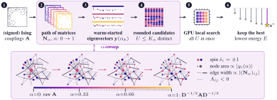

<h1 align="center">Spectral Annealing: Normalization-Path Exploration<br>for Large-Scale Ising Optimization</h1>

<p align="center">
  Juan Valentin Guerrero Cano*, Phuong Cao Cong*, Kostadin Damevski, Thang Dinh<br>
  Department of Computer Science, Virginia Commonwealth University<br>
  <b>NeurIPS 2026</b> · *Equal contribution · Contact: guerrerocajv@vcu.edu, congp@vcu.edu
</p>

<p align="center">
  
</p>
<p align="center"><sub><b>Overview of SpecAnn</b> (step 6 is schematic). Bottom: the α-sweep (steps 2–4) on a toy signed
graph (n = 36) at four of the 128 values of α in the schedule.</sub></p>

This repository contains the code of SpecAnn (Spectral Annealing), a GPU solver for large Ising problems. From the
paper:

- **From one eigenvector to a search.** SpecAnn sweeps a path of normalizations, from the raw adjacency to the signed
  normalized Laplacian, instead of solving one eigenvalue problem.
- **Fast along the path.** Each eigensolve is warm-started by an O(n) diagonal predictor, and a GPU-batched local
  search refines all the candidates in parallel.
- **Large scale.** SpecAnn runs in less than 35 minutes on instances of 33.6M variables, a scale only spectral
  methods reach. It runs up to 67× faster than a recent GPU-accelerated method at million-variable scale, with
  competitive solution quality.

## What SpecAnn does

SpecAnn looks for a spin vector s ∈ {−1, +1}ⁿ with low Ising energy E(s) = −½ sᵀJs, where J is the coupling
matrix of a graph. MaxCut and many QUBO problems can be written this way.

A single spectral relaxation (one eigenvector of one matrix) gives one candidate solution. SpecAnn instead follows a
path of normalized matrices, controlled by α ∈ [0, 1]:
- **α = 0:** the adjacency matrix (the spectral method we call SpecAdj);
- **α = 1:** the normalized signed Laplacian (SpecSignedLap).

At each α of the path, SpecAnn:
1. computes the leading eigenvector on the GPU, starting from the eigenvector of the previous α (a warm start that
   reduces the eigensolver's iterations);
2. rounds it to a spin vector: +1 where the eigenvector is ≥ 0, −1 elsewhere.

Then it refines the distinct spin vectors with a local search that runs on the GPU in one batch, and returns the
best one found along the path.

## Installation

You need an NVIDIA GPU with CUDA 12, and Python 3.11.

```bash
pip install -r requirements.txt
```

## Changes to other libraries

**Optional: the Lanczos iteration count.** The solvers can record how many Lanczos iterations each eigenvector needs
(column `eigsh_iterations` of the results). CuPy's `cupyx.scipy.sparse.linalg.eigsh` counts them internally but does
not return the count. A one-line change to CuPy makes it return the count as a third value; the eigenvalues and
eigenvectors it computes do not change. The commands, and how to undo the change, are in
[`docs/cupy_eigsh_patch.md`](docs/cupy_eigsh_patch.md). We used it for the paper's results (the warm-start study
counts iterations).

Without the change everything runs: the `eigsh_iterations` column stays empty, and the solvers check the convergence
of every eigenpair from its residual (with the change, only when `eigsh` reaches its iteration limit).

## Usage

Run from the repository root:

```bash
python main.py --solver SpecAnn --dataset Gset --instance G1.txt              # G1, 10 seeds
python main.py --solver SpecAnn --dataset barabasi_albert_10ins_m20 --num-seeds 3
python main.py --solver SpecAdj --dataset erdos_renyi_10ins_m20 --instance er_1024_1_0.txt --seed 42
python main.py --solver SpecAnn --dataset Gset --instance G1.txt --save-spins # also write the spin vectors
```

- `--solver` takes a run name from `configs/default.yml` (next section).
- `--dataset` is a folder of `datasets/`.
- Without `--instance`, every instance of the dataset runs.
- Gset and the signed networks are not in this repository: download them first (see Datasets).

**Other options:**

| Option | Effect |
|---|---|
| `--num-seeds K` | run K seeds per instance (default: 10, from 42) |
| `--seed S` | start from seed S; alone, run only seed S |
| `--save-spins` | also write each run's best spin vector |
| `--config NAME` | read `configs/NAME.yml` instead of `configs/default.yml` |

## Run names

A run name in `configs/default.yml` is a solver with its parameters. It also names the results folder.

| Run name | What it is |
|---|---|
| `SpecAnn` | SpecAnn as in the paper: 128 values of α in [0, 1], single precision, batched local search |
| `SpecAnn-64` | double precision |
| `SpecAnn-LS` | without the local search |
| `SpecAnn-cold` | without the warm start: every eigenvector starts from a random vector |
| `SpecAnn-sec` | another way to predict the next eigenvector (secant instead of diagonal) |
| `SpecAnn-guard-adaptive` | local search with an energy guard (parameter `ls_policy`) |
| `SpecAnn-sched-example` | an example of another path of α (`schedule`, `schedule_interval`, `num_alphas`) |
| `SpecAdj` | only α = 0, the same local search |
| `SpecSignedLap` | only α = 1, the same local search |

**To make your own run,** add a run name with its `solver_name` and `params`. The constructors in
`models/spectral_annealing.py`, `models/spec_adj.py` and `models/spec_signed_lap.py` list every parameter.

## Datasets

`datasets/` holds part of the paper's instances. We chose not to include the very large ones (the paper's
Barabási–Albert and Erdős–Rényi graphs go up to n = 2²⁵ ≈ 33.6 million), to keep the repository small:

| Folder | Instances |
|---|---|
| `barabasi_albert_10ins_m20/` | Barabási–Albert graphs, m = 20, n = 64 to 4,096, 10 graphs per size |
| `erdos_renyi_10ins_m20/` | Erdős–Rényi graphs, n = 64 to 4,096, 10 graphs per size |
| `barabasi_albert_3ins_m10_tiny/` | small Barabási–Albert graphs, m = 10, n = 20 to 190, 3 graphs per size |

**Other instances.** If you need an instance of the paper that is not in this repository, please write to us (see
the contact at the top of this README).

**Gset (not included).** The paper uses the 66 connected graphs of the Gset MaxCut collection (n = 800 to 20,000).
It leaves out the 5 disconnected ones (G55, G56, G60, G61 and G70). Download the 66 files (G1–G54, G57–G59, G62–G67,
G72, G77 and G81) from [Yinyu Ye's Gset page](https://web.stanford.edu/~yyye/yyye/Gset/) and save each one as
`datasets/Gset/G<i>.txt` (for example, `G1` as `datasets/Gset/G1.txt`). The files are the ones of the paper.

```bibtex
@misc{ye2003gset,
  author = {Yinyu Ye},
  title  = {The Gset Dataset},
  year   = {2003},
  url    = {https://web.stanford.edu/~yyye/yyye/Gset/}
}
```

**Signed networks (not included).** The paper also uses three signed social networks from SNAP
(Leskovec, Huttenlocher and Kleinberg, 2010):
- Epinions: [soc-sign-epinions](https://snap.stanford.edu/data/soc-sign-epinions.html) (131,828 nodes);
- Slashdot: [soc-sign-Slashdot090221](https://snap.stanford.edu/data/soc-sign-Slashdot090221.html) (82,144 nodes);
- Wikipedia elections: [wiki-Elec](https://snap.stanford.edu/data/wiki-Elec.html) (about 7,000 nodes).

They are available from SNAP under its terms of use. Download the `.gz` files from the pages above, then convert them
with `datasets/snap_signed_to_txt.py`. The script gives the files of the paper:

```bash
mkdir -p datasets/real_world
python datasets/snap_signed_to_txt.py edges soc-sign-epinions.txt.gz datasets/real_world/epinions.ising.txt
python datasets/snap_signed_to_txt.py edges soc-sign-Slashdot090221.txt.gz datasets/real_world/slashdot.ising.txt
python datasets/snap_signed_to_txt.py wikielec wikiElec.ElecBs3.txt.gz datasets/real_world/wikielec.ising.txt
```

The SNAP networks are directed. The script makes them undirected:
- it adds the signs of all arcs between two users (both directions, every vote);
- the edge gets the sign of the sum: J = +1 or J = −1;
- a pair whose arcs cancel (as many +1 as −1) gets no edge;
- self-loops are removed;
- every field is 0.

```bibtex
@inproceedings{leskovec2010signed,
  title     = {Signed networks in social media},
  author    = {Leskovec, Jure and Huttenlocher, Daniel and Kleinberg, Jon},
  booktitle = {Proceedings of the SIGCHI Conference on Human Factors in Computing Systems},
  pages     = {1361--1370},
  year      = {2010},
  doi       = {10.1145/1753326.1753532}
}
```

**How the Barabási–Albert and Erdős–Rényi graphs were generated:**
- **Barabási–Albert:** the graph grows by preferential attachment. Each new node links to m = 20 existing nodes
  (m = 10 in `barabasi_albert_3ins_m10_tiny`).
- **Erdős–Rényi:** each pair of nodes is linked with probability p = 2m/n = 40/n. Thus the mean degree is about 40, as
  in a large Barabási–Albert graph with m = 20.
- **Tools:** the graphs up to n = 2²⁰ were made with NetworkX (`barabasi_albert_graph`, `erdos_renyi_graph`), the
  larger ones with igraph (`Graph.Barabasi`, `Graph.Erdos_Renyi`). A graph with an isolated node was drawn again.
- **Weights:** every coupling J_ij and every field h_i is an integer drawn uniformly from [−100, 100].
- **Files:** each size has 10 graphs (3 in the tiny set), in files `ba_<n>_1_<i>.txt` and `er_<n>_1_<i>.txt`, with
  i = 0, …, 9. The `1` is a label of the generator; it has no meaning here.

The files are the reference instances. They cannot be made again exactly from a seed.

**File formats.** The loader picks the format from the folder name:
- **A folder whose name contains `Gset`:** the first line is `n m`, then one line `i j w` per edge (nodes numbered
  from 1). The weights are negated, so that the lowest energy is the largest cut.
- **Any other folder:** the first line is `n m`, then n lines with the field hᵢ of each node, then one line
  `i j J` per coupling (nodes numbered from 1). Nonzero fields are handled with one extra spin.

**To use your own instances,** make a new folder in `datasets/` and write the files in one of these formats.

## Results

Each run writes to `results/<dataset>/<run name>/`:

| File | Content |
|---|---|
| `<instance>.csv` | one row per seed: the energy, the time in seconds (without reading the file) and the settings |
| `alphas/<instance>_alphas.csv` | one row per α: the eigenvalue, the eigensolver's iterations, the energy before and after the local search |
| `solutions/<instance>__seed<s>.sol` | with `--save-spins`: the best spin vector (one line `node spin` per node of the file; nodes without couplings are left out) and its energy |

`utils/solution_io.load_solution` reads a `.sol` file back. If a run fails (for example, the GPU runs out of
memory), the other runs go on; `main.py` lists the failed runs at the end and exits with code 2.

**The local search runs in parallel, so results can change with the GPU.** In each pass, the GPU updates most
nodes at the same time, and the order of the threads changes with the GPU and from run to run. Thus the energies of
two runs with the same seed can be a little different. On a few small dense graphs, a pass can make a candidate
worse; SpecAnn then keeps the candidate from before the local search. Example: on G1 (800 nodes), the local search
gives no gain for 5 of 10 seeds on an A100, and for the 3 seeds we tried on a laptop GPU (RTX 4060).

## Contributing

Contributions are welcome. Please open an issue or a pull request if you:
- find a bug, or something that does not work as this README says;
- want to suggest or add a feature, for example another local search, another path of α, or another instance format.

For a bug, please give the command you ran, the instance (or a small one that shows the problem) and the output.

## AI declaration

The authors designed SpecAnn. AI coding assistants helped to build the code, especially in its final stage, after the
method was designed.

## Citation

```bibtex
@inproceedings{guerrerocano2026specann,
  title     = {Spectral Annealing: Normalization-Path Exploration for Large-Scale Ising Optimization},
  author    = {Guerrero Cano, Juan Valentin and Cao Cong, Phuong and Damevski, Kostadin and Dinh, Thang},
  booktitle = {Advances in Neural Information Processing Systems},
  year      = {2026}
}
```

## License

SpecAnn is released under the [MIT License](LICENSE).
